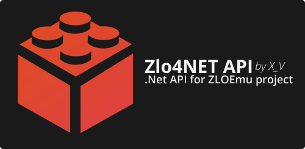
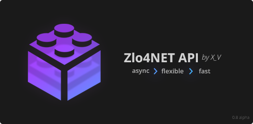

## Description




**Zlo4NET API** is an API project for developing launchers for *Battlefield* series games for the **ZLOEmu** project. It was created to make launcher development using **WinForms** and **WPF** technologies more flexible and convenient.

## Installation and Dependencies

To use **Zlo4NET API** in your project, you can choose one of the following connection methods:

* *Using the **NuGet** package manager*

Open the NuGet package manager and install the following packages into your project:

1. Newtonsoft.Json
2. Zlo4NET

* *Using offline assemblies*

Add the following assemblies to your project via References:

1. Newtonsoft.Json.dll
2. Zlo4NET.dll

## Available Features

* asynchronously connect to *ZClient* and track connection state
* asynchronously retrieve the server list and its updates
* obtain *debug* information
* asynchronously launch games without using *ZLOrigin*
* retrieve information from the game's *pipe*
* safely inject *dll* into the game process **(not cheats)**
* asynchronously retrieve player statistics for BF3 and BF4

To see what is planned and what is currently being developed, visit [**Trello**](https://trello.com/b/soZz4WYB).

## Getting Started

#### Accessing the API

The API uses the *Singleton* pattern, so you will always have access to the same API object: `var apiClient = ZApi.Instance;`. The object is created upon the first access to the `Instance` property.

#### API Configuration

At the beginning of your work with the API, you need to configure it by calling the `Configure(ZConfiguration config)` method. Since some operations must be executed in the *UI* thread context, you should pass your UI context object `SynchronizationContext.Current` into the configuration. `SynchronizationContext.Current` must be called on your *UI* thread; otherwise, an incorrect context will be captured.

**Example:**

```csharp
var apiClient = ZApi.Instance;
var configuration = new ZConfiguration
{
	SynchronizationContext = SynchronizationContext.Current
};
apiClient.Configure(configuration);
```

The `Configure(...)` method can only be called once.

#### Connecting to ZClient

To use the API, you need to establish a connection with *ZClient*. To connect, obtain the `IZConnection` service and call its `Connect()` method. Then monitor the `ConnectionChanged` event to know when the connection state changes. You can also terminate the connection early by calling the `Disconnect()` method. Connection and disconnection cycles are not limited.

**Example:**

```csharp
var apiClient = ZApi.Instance;
var connection = apiClient.Connection;

connection.ConnectionChanged += ApiConnectionChangedHandler;
connection.Connect();

void ApiConnectionChangedHandler(object sender, ZConnectionChangedArgs e) {
	var connectionState = e.IsConnected;
	var authUser = e.AuthorizedUser;
	// do something
}

connection.Disconnect();
```

#### Retrieving the Server List

To retrieve the server list, you need to create a special service by calling `CreateServersListService(...)`, passing the required game. The result will be an `IZServersListService`.

When you are ready to start populating and updating the list, call the `StartReceiving()` method. To access the server list, use the `ServersCollection` property.

**Example:**

```csharp
var apiClient = ZApi.Instance;
var serversService = apiClient.CreateServersListService(ZGame.BF3);
m_bindableServersList = serversService.ServersCollection;
serversService.StartReceiving();
```

The API does not calculate *ping* values for each server but provides an event that allows you to calculate *ping* in one go. After receiving the full server list, the `InitialSizeReached` event will be triggered. This event is fired only once.
Changes in the number of servers can be tracked via the `CollectionChanged` event on the list object.

**Example:**

```csharp
var serversService = apiClient.CreateServersListService(ZGame.BF3);
var collection = serversService.ServersCollection;

serversService.InitialSizeReached += ServersInitialSizeReachedHanlder;
collection.CollectionChanged += ServersListChangedHandler;

void ServersInitialSizeReachedHanlder(object sender, EventArgs e)
{
	// do something
}

void ServersListChangedHandler(object sender, NotifyCollectionChangedEventArgs e)
{
	// do something
}
```

Note that you can access the last created service via the API property `ServersListService`.
If you no longer need this service, call the `StopReceiving()` method. It will release resources and close the object for further use. To check whether the service is still available via `ServersListService`, verify the `CanUse` property.

**Example:**

```csharp
var apiClient = ZApi.Instance;
var serversService = apiClient.ServersListService;

if (serversService.CanUse)
{
	serversService.StopReceiving();
}
```

#### Creating and Running a Game

To launch a game, you need to create it using the `IZGameFactory`.

**Example:**

```csharp
var apiClient = ZApi.Instance;
var game = await apiClient.GameFactory.CreateSingleAsync(new ZSingleParams 
{
	Game = ZGame.BF4,
	PreferredArchitecture = ZGameArchitecture.x64
});
var runResult = await game.RunAsync();
```

#### Injector

Allows loading code from specified assemblies (reshades) into the game process without the risk of being banned.

**Example:**

```csharp
var apiClient = ZApi.Instance;
var dlls = new { "C:\\bf3_disableBlueShit.dll" };
apiClient.Inject(ZGame.BF3, dlls);
```

#### Retrieving Player Statistics

Player statistics can be obtained directly from the API object. Simply call the `GetStatsAsync(...)` method, passing the required game as a parameter. It returns an abstract class `ZStatsBase`, which should be cast to the appropriate type: `ZBF3Stats` for *Battlefield 3* and `ZBF4Stats` for *Battlefield 4*.

**Example:**

```csharp
var apiClient = ZApi.Instance;
var stats = (ZBF3Stats) await apiClient.GetStatsAsync(ZGame.BF3);
```

#### Retrieving Error Information

You can access API debug information via the `OnMessage` event.

**Example:**

```csharp
var apiClient = ZApi.Instance;
var logger = apiClient.Logger;
logger.OnMessage += ApiLoggerMessageHandler;

void ApiLoggerMessage(object sender, ZLogMessageArgs e) {
	// do something
}
```

## Changelog

**v0.1.8.0 alpha**

* XML documentation implemented

## Contact

If you have any questions, contact me on Discord (XrIStOs#6552).

## Acknowledgements

* **bigworld12** (examples and motivation)
* **ZLOFENIX** (answered all questions, incredible patience)
* **ZLOEMU project administration** (understanding and support)

## Types

## Enums
#### ZGame
Defines the Battlefield games

| Value      | Description                 |
|------------|-----------------------------|
| BF3 = 0    |The Battlefield 3 game       |
| BF4        |The Battlefield 4 game       |
| BFH        |The Battlefield Hardline game|
| None = 255 |-                     |

#### ZCoopDifficulty
Defines CoOp difficulty level

|Value|Description|
|-----|-----------|
|Easy = 0|Easy difficulty|
|Normal|Normal difficulty|
|Hard|Hard difficulty|

#### ZCoopLevels
Defines CoOp level codes

|Value|Description|
|-----|-----------|
|COOP_007 = 0|Operation Exodus|
|COOP_006|Fire from the Sky|
|COOP_009|Exfiltration|
|COOP_002|Hit and Run|
|COOP_003|Drop 'Em Like Liquid|
|COOP_010|The Eleventh Hour|

#### ZGameArchitecture
Defines game architecture

|Value|Description|
|-|-|
|x64 = 0|x64 architecture|
|x32|x86 architecture|

#### ZRunResult
Defines ZClient game run result

|Value|Description|
|-|-|
|Success = 0|Success|
|NotFound|Target game not found|
|Error|Some error|
|None|Stub|

#### ZRole
Defines player roles

|Value|Description|
|-|-|
|Soldier = 0|Soldier role. Supports on All games|
|Commander|Commander role. Supports on Battlefield 4 \*only (\*Hardline maybe to)|
|Spectator|Spectator role. Supports on Battlefield 4 \*only (\*Hardline maybe to)|

#### ZPlayMode
Defines play modes

|Value|Description|
|-|-|
|Singleplayer|Singleplayer|
|Multiplayer|Multiplayer|
|CooperativeHost|Cooperative host|
|CooperativeClient|Cooperative client|
|TestRange|Test range|

#### ZLogLevel
Defines log level

|Value|Description|
|-|-|
|Info|Info|
|Debug|Debug|
|Warning|Warning|
|Error|Error|

## Stats models
#### ZStatsBase, ZBF3Stats and ZBF4Stats 
Defines base stats. Property name as documentation

## Run game params models
#### ZSingleParams
Defines launch options for a singleplayer

|Property|Get\Set|Description|
|-|-|-|
|ZGame Game|++|Gets or sets the target game. Require|
|ZGameArchitecture? PreferredArchitecture|++|Gets or sets preferred game architecture. Optional. Default value is `null`|

#### ZMultiParams
Defines launch options for a multiplayer

|Property|Get\Set|Description|
|-|-|-|
|ZGame Game|++|Gets or sets the target game. Require|
|ZGameArchitecture? PreferredArchitecture|++|Gets or sets preferred game architecture. Optional. Default value is `null`|
|uint ServerId|++|Gets or sets server ZloID. Require|
|ZRole Role|++|Gets or sets player role. Default value is `ZRole.Soldier`|

#### ZTestRangeParams
Defines launch options for a test range (playground).

|Property|Get\Set|Description|
|-|-|-|
|ZGame Game|++|Gets or sets the target game. Require|
|ZGameArchitecture? PreferredArchitecture|++|Gets or sets preferred game architecture. Optional. Default value is `null`|

#### ZCoopParams
Defines launch options for a cooperative

|Property|Get\Set|Description|
|-|-|-|
|ZPlayMode Mode|++|Gets or sets play mode. Allow values is `ZPlayMode.CooperativeClient` or `ZPlayMode.CooperativeHost`. Required|
|ZGameArchitecture? PreferredArchitecture|++|Gets or sets preferred game architecture. Optional. Default value is `null`|
|ZCoopLevels? Level|++|Gets or sets level (mission) code. Required for `ZPlayMode.CooperativeHost` play mode. Default value is `null`|
|ZCoopDifficulty? Difficulty|++|Gets or sets difficulty level. Required for `ZPlayMode.CooperativeHost` play mode. Default value is `null`|
|uint? FriendId|++|Gets or sets cooperative host (friend) ZloID. Required for `ZPlayMode.CooperativeClient` play mode. Default value is `null`|

## Event args models
#### ZGamePipeArgs : EventArgs
Defines game pipe event args

|Property|Get\Set|Description|
|-|-|-|
|string FullMessage|+ -|Gets full pipe message|
|string FirstPart|+ -|Gets only first part of pipe message|
|string SecondPart|+ -|Gets only second part of pipe message|

#### ZConnectionChangedArgs : EventArgs
Defines connection changed event args

|Property|Get\Set|Description|
|-|-|-|
|bool IsConnected|+ -|Gets connection state|
|ZUser AuthorizedUser|+ -|Gets authorized user|

#### ZLogMessageArgs : EventArgs
Defines log event args

|Property|Get\Set|Description|
|-|-|-|
|ZLogLevel Level|+ -|Gets message level|
|string Message|+ -|Gets message|

## Other
#### ZConfiguration
Defines api configuration

|Property|Get\Set|Description|
|-|-|-|
|SynchronizationContext SynchronizationContext|++|Gets or sets UI synchronization context|

#### ZUser
Defines Zlo user

|Property|Get\Set|Description|
|-|-|-|
|uint Id|++|Gets ZloID|
|string Name|++|Gets ZloName|

## Server models

#### abstract ZServerBase : ZObservableObject

Defines base server

|Property|Get\Set|Description|IsObservable|
|-|-|-|-|
|uint Id|++|Gets the ZloID|-|
|string Name|++|Gets name|-|
|IPAddress Ip|++|Gets ip address|-|
|uint Port|++|Gets port number|-|
|int Ping|++|Gets signal delay in ms. By default it is not calculated. This field is observable|+|
|ZGame Game|++|Gets target game|-|
|abstract byte SpectatorsCapacity|++|Gets capacity of spectators|-|
|byte PlayersCapacity|++|Gets capacity of players. This field is observable|+|
|byte CurrentPlayersNumber|++|Gets number of current players. This field is observable|+|
|ZMap CurrentMap|++|Gets current map|+-|
|ObservableCollection<ZPlayer> Players|++|Gets list of players|+-|
|IEnumerable<ZMap> SupportedMaps|++|Gets list of supported maps|-|
|ZAttributesBase Attributes|++|Gets attributes|-|
|IDictionary<string, string> Settings|++|Gets settings|-|

#### ZBF3Server : ZServerBase

Defines the Battlefield 3 server

|Property|Get\Set|Description|IsObservable|
|-|-|-|-|
|override byte SpectatorsCapacity|throw NotSupportedException|This property not supported on Battlefield 3|-|

#### ZBF4Server : ZServerBase

Defines the Battlefield 4 server

|Property|Get\Set|Description|IsObservable|
|-|-|-|-|
|override byte SpectatorsCapacity|++|Gets capacity of spectators|-|

#### ZBFHServer : ZServerBase

Defines the Battlefield Hardline server

|Property|Get\Set|Description|IsObservable|
|-|-|-|-|
|override byte SpectatorsCapacity|++|Gets capacity of spectators|-|

#### abstract class ZAttributesBase

Defines basic server attributes

|Property|Get\Set|Description|
|-|-|-|
|string BannerUrl|+ -|Gets the banner url|
|string Country|+ -|Gets country code|
|string Message|+ -|Gets server message|
|string Mod|+ -|Gets ???|
|string Preset|+ -|Gets preset name|
|string PunkBusterVersion|+ -|Gets PunkBuster version|
|string Region|+ -|Gets region code|
|string Description|+ -|Gets description|
|abstract string FairFight|+ -|Gets an indication of the presence of a FairFight|
|abstract string ServerType|+ -|Gets type of server|
|abstract string TickRate|+ -|Gets tick rate|

#### ZBF3Attributes : ZAttributesBase

Defines the Battlefield 3 server attributes

|Property|Get\Set|Description|
|-|-|-|
|override string ServerType|throw NotSupportedException|The Battlefield 3 not supported this attribute|
|override string FairFight|throw NotSupportedException|The Battlefield 3 not supported this attribute|
|override string TickRate|throw NotSupportedException|The Battlefield 3 not supported this attribute|

#### ZBF4Attributes : ZAttributesBase

Defines the Battlefield 4 server attributes

|Property|Get\Set|Description|
|-|-|-|
|override string ServerType|+ -|Gets type of server|
|override string FairFight|+ -|Gets an indication of the presence of a FairFight|
|override string TickRate|+ -|Gets tick rate|

#### ZBFHAttributes : ZAttributesBase

Defines the Battlefield Hardline server attributes

|Property|Get\Set|Description|
|-|-|-|
|override string ServerType|+ -|Gets type of server|
|override string FairFight|+ -|Gets an indication of the presence of a FairFight|
|override string TickRate|+ -|Gets tick rate|

#### ZPlayer

Defines player

|Property|Get\Set|Description|
|-|-|-|
|byte Slot|++|Gets player slot number|
|uint Id|++|Gets player ZloID|
|string Name|++|Gets name of player|

#### ZMap : ZObservableObject

Defines server map

|Property|Get\Set|Description|IsObservable|
|-|-|-|-|
|string Name|++|Gets name of map|+|
|string GameModeName|++|Gets name of game mode|+|

## Helpers

#### ZResource

Provides some resources for general use

|Method|Description|Params|Exceptions|Return|
|-|-|-|-|-|
|`static string[] GetBF3MapNames()`|Gets Battlefield 3 maps array|-|-|String array of map names|
|`static string[] GetBF4MapNames()`|Gets Battlefield 4 maps array|-|-|String array of map names|
|`static string[] GetBFHMapNames()`|Gets Battlefield Hardline maps array|-|-|String array of map names|
|`static string[] GetBF3GameModeNames()`|Gets Battlefield 3 game modes array|-|-|String array of game mode names|
|`static string[] GetBF4GameModeNames()`|Gets Battlefield 4 game modes array|-|-|String array of game mode names|
|`static string[] GetBFHGameModeNames()`|Gets Battlefield Hardline game modes array|-|-|String array of game mode names|

#### ZPingService

Helps calculate roundtrip delay of the server

|Method|Description|Params|Exceptions|Return|
|-|-|-|-|-|
|`static int GetPing(IPAddress address)`|Calculate roundtrip delay of the `address`|`address` - IP address for which the calculation will be executed|-|Calculated delay time. If is over 999, then return 999|

## Service

#### interface IZApi

Defines the ZloApi

##### Methods

|Method|Description|Params|Exceptions|Return|
|-|-|-|-|-|
|`Task<ZStatsBase> GetStatsAsync(ZGame game)`|Makes an asynchronous request to get current soldier statistics|`game` - Game context|`NotSupportedException` - Occurs when specifying the Battlefield Hardline parameter; `InvalidOperationException` - Occurs when Api is not connected|A task that represents the asynchronous get soldier statistics operation|
|`IZServersListService CreateServersListService(ZGame game)`|Creates and returns an implementation of `IZServersListService`|`game` - Game context|`InvalidOperationException` - Occurs when trying to create a service in an non-configured Api or Api is not connected; `InvalidEnumArgumentException` - Occurs when a parameter is set to an invalid value|Implementation of `IZServersListService`|
|`void InjectDll(ZGame game, string[] paths)`|Makes asynchronous requests to inject specified dlls into the game process|`game` - Game context; `paths` - An array of dll paths for injection|`InvalidOperationException` - Occurs when Api is not connected|-|
|`void Configure(ZConfiguration config)`|Configures api|`config` - Configuration instance|`InvalidOperationException` - Occurs when this method is called more than once; `ArgumentNullException` - Occurs when `config` is null; `ArgumentException` - Occurs when `ZConfiguration.SynchronizationContext` is not specified|-|

##### Properties

|Property|Get\Set|Description|
|-|-|-|
|`IZGameFactory GameFactory`|+ -|Gets game factory|
|`IZConnection Connection`|+ -|Gets API connection|
|`IZLogger Logger`|+ -|Gets API logger|
